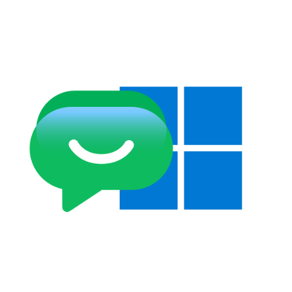
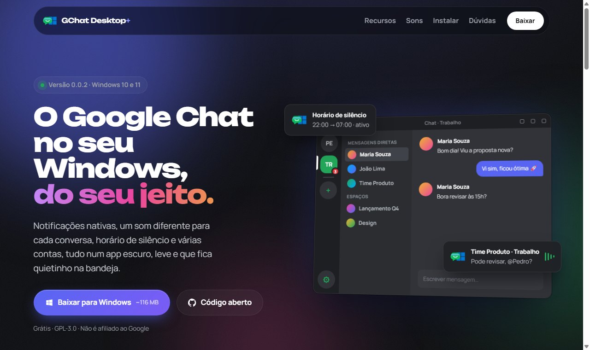
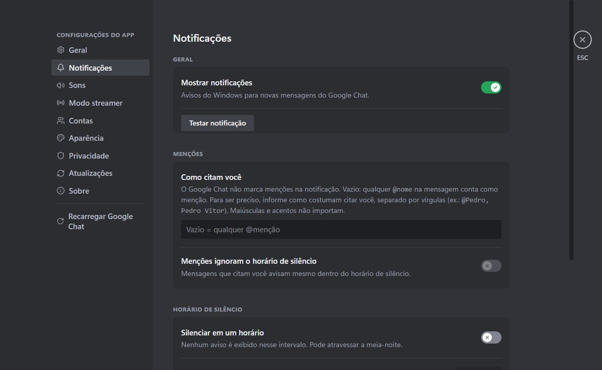
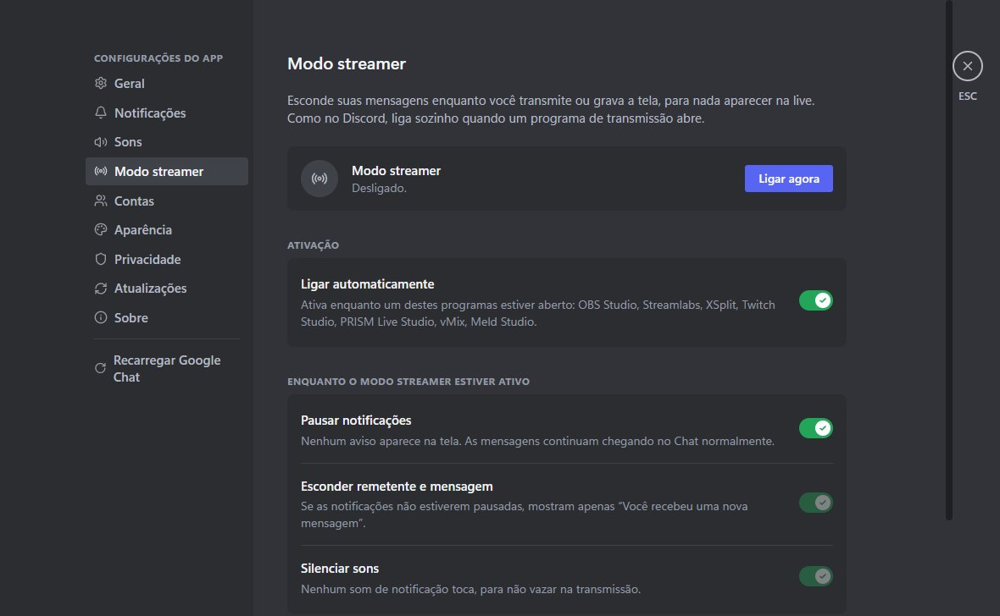
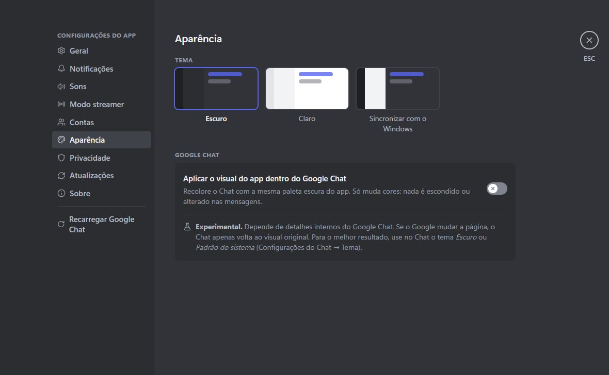
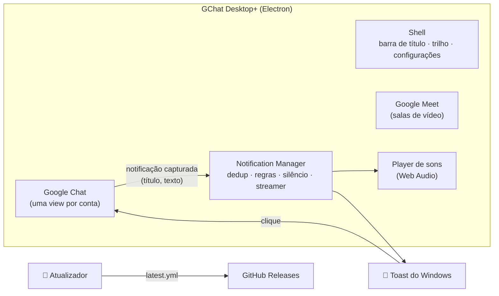

<div align="center">



# GChat Desktop+

**O Google Chat no seu Windows, do seu jeito.**

Notificações nativas, um som diferente para cada conversa, horário de silêncio, modo
streamer, várias contas e salas de vídeo do Google Meet, num app escuro e leve que fica
quietinho na bandeja.

[](https://github.com/PedroVitor-Dev/GChat_Desktop/releases/latest)
[](https://github.com/PedroVitor-Dev/GChat_Desktop/releases)
[](#-instalação)
[](LICENSE)

[**⬇️ Baixar para Windows**](https://github.com/PedroVitor-Dev/GChat_Desktop/releases/latest)
&nbsp;·&nbsp;
[**🌐 Site**](https://pedrovitor-dev.github.io/GChat_Desktop/)
&nbsp;·&nbsp;
[**📚 Documentação**](#-documentação)

<br />



</div>

---

## ✨ Recursos

<table>
<tr>
<td width="50%" valign="top">

### 🔔 Notificações de verdade

Avisos nativos do Windows com remetente e mensagem. O clique abre a conversa, e o
botão **Silenciar conversa** fica direto na notificação. Nada de aviso duplicado.

### 🎵 Sons do seu jeito

Cinco sons originais incluídos, ou **importe MP3, WAV e OGG**. Volume, prévia,
**som por conversa** e **som de menção**. O som do próprio Chat é substituído pelo
seu.

### 🌙 Não perturbe e horário de silêncio

Pause avisos e sons por **30 min, 1 h, 8 h ou até amanhã** com um clique no sino do
trilho ou na bandeja; volta sozinho. E nada de aviso fora do expediente: **menções
podem furar o horário de silêncio**, se você quiser. E as **pessoas prioritárias** ⭐
sempre avisam, com som próprio, mesmo no Não perturbe ou no modo streamer.
O que chegou com você fora fica na **caixa de notificações perdidas**, só na memória.

### 📡 Modo streamer

Liga sozinho com **OBS, Streamlabs, XSplit, Twitch Studio, PRISM, vMix e Meld**:
pausa as notificações, esconde o conteúdo e silencia os sons. Selo roxo na barra de
título, como no Discord.

</td>
<td width="50%" valign="top">

### 🎧 Salas de vídeo (Google Meet)

Salas permanentes, como os **canais de voz do Discord**. Crie com um clique, mande o
link aos amigos e fique em chamada **com cronômetro**. Ao voltar ao Chat, a chamada vira
um **miniplayer flutuante**; na tela dela, **modo foco** e **tela cheia**. **Supressor de ruído**
opcional, com IA rodando no seu computador.

### 📌 Conversas fixadas

Um painel ao lado do Chat, como a lista de canais de um servidor no Discord, com os
**grupos e conversas do dia a dia**: organize em grupos, arraste, escolha emojis, veja quantas
mensagens chegaram e abra com um clique (ou **Alt + 1…9**), na hora.

### 👥 Várias contas

Até **5 contas Google** com sessões isoladas, alternando com `Ctrl + 1…5`. A foto do
seu perfil fica no trilho, com a **bolinha de status e o emoji** do seu status do Chat.
Um clique nela muda o status (Não perturbe, Ausente ou uma frase com emoji e prazo).

### 🧊 Quietinho na bandeja

Fechar a janela mantém o app avisando. Abre com o Windows, inicia minimizado e lembra
a posição, até em outro monitor.

### 🔄 Atualização automática

Novas versões chegam pelo próprio app, conferidas (SHA-512) e instaladas em silêncio,
**sem perder nada**.

</td>
</tr>
</table>

### 🎨 Visual inspirado no Discord

Barra de título própria, trilho de ícones e configurações em tela cheia (`Esc` fecha).
**Temas personalizados:** Escuro, Claro ou do Windows, 11 temas coloridos com degradê
(Aurora, Oceano, Crepúsculo…) ou o seu, com cor de destaque, cor de fundo e degradê.
A janela pode ser **sólida, Mica ou Acrílico** (Windows 11), com transparência
ajustável e prévia ao vivo. Um tema experimental leva as cores para dentro do Chat.

<div align="center">



</div>

---

## 📥 Instalação

1. Baixe o **[instalador mais recente](https://github.com/PedroVitor-Dev/GChat_Desktop/releases/latest)**
   (`GChat-Desktop-Plus-Setup-x.y.z-x64.exe`, ~116 MB).
2. Abra e siga o assistente em português. Não precisa de administrador.
3. Entre com sua conta Google **na página oficial do Google**. Pronto.

> [!NOTE]
> O instalador ainda não tem assinatura digital paga. Se aparecer **“O Windows protegeu
> o computador”**, clique em **Mais informações → Executar assim mesmo**. O código é
> aberto e o instalador é gerado automaticamente pelo GitHub Actions a partir dele.

> [!TIP]
> A partir da **0.0.2**, as atualizações chegam pelo próprio app (**Configurações →
> Atualizações**). Quem está na 0.0.1 precisa instalar a versão nova uma vez.

**Requisitos:** Windows 10 ou 11, 64 bits.

---

## ⌨️ Atalhos

| Atalho                   | Ação                                                |
| ------------------------ | --------------------------------------------------- |
| `Ctrl` + `,`             | Abrir/fechar as configurações                       |
| `Esc`                    | Fechar as configurações                             |
| `Ctrl` + `1…5`           | Alternar entre contas                               |
| `Alt` + `1…9`            | Abrir uma conversa fixada                           |
| `Ctrl` + `R` / `F5`      | Recarregar o Google Chat                            |
| `Ctrl` + `=` / `-` / `0` | Zoom do Chat                                        |
| `Alt` + `←`              | Voltar no Chat                                      |
| `Ctrl` + `Q`             | Sair do app (fechar a janela só esconde na bandeja) |

---

## 🔒 Privacidade e segurança

- 🔑 **Login só na página oficial do Google.** O app nunca vê nem guarda sua senha;
  verificação em duas etapas, passkeys e SSO corporativo funcionam normalmente.
- 💾 **A sessão fica no seu computador**, criptografada pelo Windows (DPAPI) para o seu
  usuário.
- 🙈 **Nada de mensagens em disco ou em logs.** As notificações perdidas ficam só na
  memória e somem ao fechar o app. Para montar o aviso, o app lê apenas o
  título e o texto da notificação que o próprio Chat cria.
- 🖼️ **Do seu perfil, só a foto e o nome** que o Chat mostra, guardados localmente, assim como a frase do seu status. O e-mail não é lido.
- 🌐 **Nada é enviado a outros servidores** além dos do Google (e do GitHub, para
  checar atualizações).
- 🛡️ Electron com `sandbox`, `contextIsolation`, sem Node na página, IPC validado,
  navegação restrita ao Google e permissões em lista branca.
- 🎭 **Não falsifica a identidade do navegador** nem altera o conteúdo das mensagens.

---

## 🧠 Como funciona

O app abre o **Google Chat oficial** em uma janela própria, uma sessão isolada por
conta. Não há extensão, API não oficial ou navegador aberto.



Os detalhes das decisões, inclusive por que o app não usa extensão de navegador, estão
em [docs/decisao-arquitetura.md](docs/decisao-arquitetura.md).

---

## 🛠️ Desenvolvimento

**Stack:** Electron 45 · React 19 · TypeScript · Tailwind CSS 4 · Vite (electron-vite) ·
electron-builder · Vitest

```bash
npm install          # instala as dependências
npm run dev          # roda o app em modo desenvolvimento
npm run check        # typecheck + lint + formatação + testes
npm run build        # build de produção
```

Instalador local (gera em `apps/desktop/release/`):

```bash
npm run dist -w @gchat/desktop
```

<details>
<summary><b>📁 Estrutura do projeto</b></summary>

```
apps/desktop/
├─ src/main/          # processo principal: shell, chat, notificações, sons, salas,
│                     # bandeja, atualizações, perfil, configurações
├─ src/preload/       # pontes mínimas (configurações, Chat, player de áudio)
├─ src/renderer/      # interface React (shell, configurações, salas)
├─ src/shared/        # tipos e validações compartilhados (com testes)
├─ resources/         # ícones, sons e arte do instalador
└─ electron-builder.yml
site/                 # landing page (GitHub Pages)
docs/                 # documentação técnica
```

</details>

<details>
<summary><b>🚀 Publicar uma versão</b></summary>

1. Escreva as novidades no topo de `apps/desktop/src/shared/changelog.json` (aparecem na
   aba Atualizações do app e nas notas do Release; um teste cobra isso). Atualize
   `version` em `apps/desktop/package.json` (e na raiz) e `VERSION` em `site/script.js`.
2. Faça o commit e o push. Depois, crie e envie a tag:

```bash
git tag v0.0.7
git push origin v0.0.7
```

O workflow **Release** roda os testes, gera o instalador e publica no Release o
`.exe`, o `.blockmap` e o `latest.yml`. Os apps instalados recebem a atualização
sozinhos. O site é publicado pelo workflow **Landing page** a cada push em `site/`.

</details>

---

## 📚 Documentação

| Tema                         | Documento                                                                                                   |
| ---------------------------- | ----------------------------------------------------------------------------------------------------------- |
| Arquitetura e decisões       | [decisao-arquitetura.md](docs/decisao-arquitetura.md) · [fase-1-viabilidade.md](docs/fase-1-viabilidade.md) |
| Notificações e modo streamer | [notificacoes.md](docs/notificacoes.md)                                                                     |
| Sons                         | [sons.md](docs/sons.md)                                                                                     |
| Contas e perfil              | [contas.md](docs/contas.md)                                                                                 |
| Salas de vídeo (Meet)        | [salas.md](docs/salas.md)                                                                                   |
| Conversas fixadas            | [fixados.md](docs/fixados.md)                                                                               |
| Bandeja e segundo plano      | [segundo-plano.md](docs/segundo-plano.md)                                                                   |
| Visual e atalhos             | [visual.md](docs/visual.md)                                                                                 |
| Atualização automática       | [atualizacoes.md](docs/atualizacoes.md)                                                                     |
| Instalador e publicação      | [instalador.md](docs/instalador.md) · [publicacao.md](docs/publicacao.md)                                   |
| Microsoft Store (MSIX)       | [microsoft-store.md](docs/microsoft-store.md)                                                               |
| Desenvolvimento              | [desenvolvimento.md](docs/desenvolvimento.md) · [estrutura.md](docs/estrutura.md)                           |

---

## 🗺️ Próximos passos

- [ ] Perfil personalizável estilo Discord (banner com imagem/GIF, bio), público entre
      usuários do app
- [ ] Atalho global para mostrar/esconder o app
- [ ] Assinatura digital do instalador
- [ ] Testes de ponta a ponta automatizados

---

<div align="center">

Criado pelo **[PedroVitor-Dev](https://github.com/PedroVitor-Dev)** 🧙

Licença [GPL-3.0](LICENSE) · Google Chat e Google Meet são marcas do Google LLC.
Este projeto é independente e **não é afiliado ao Google**.

</div>
